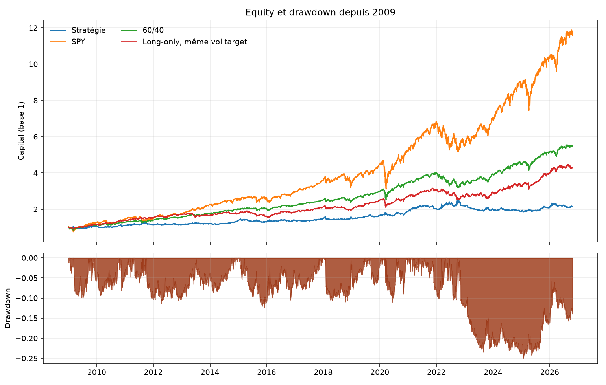

# Trend following and carry on US ETFs

The Carver framework on fourteen liquid US ETFs, from 2 January 2009 to 23 October 2026, 17.5 years at 256 days a year. The rules, the weights, and the volatility target were frozen before the first performance number. Nothing was retuned afterwards.

With the lagged T-bill charged on cash, the excess-return Sharpe is 0.31 for the strategy and 0.73 for the long-only control. SPY, unlevered, is 0.80. A daily 60/40 is 0.85. The gap versus the control is −0.42. `block_bootstrap_sharpe_difference`, 2,000 draws, seed 0, a 21-day block, gives a 95% interval of about [−1.03, +0.17]. The interval includes zero. That does not mean the two books are equivalent. It means this sample cannot separate them. A book of only the two slow trends has an excess Sharpe of 0.32, next to 0.31 for the full book.

The first circulated print, cut on 13 October and before the cash charge, was 0.41 against 1.00. On the common window the unfunded strategy Sharpe is 0.40. Those figures are the history of the note. The comparison above is the one that charges the bill and subtracts it.

The printable note is [`docs/research_paper.pdf`](docs/research_paper.pdf). A French version is [`docs/research_note.md`](docs/research_note.md).

## The book

Each evening the position in instrument $i$ is

$$
N^*_{i,t} = \frac{\text{Capital}_t \times 0.13 \times F_{i,t} \times w_i \times \text{IDM}_t}{10 \times \sigma_{i,t} \times P_{i,t}}.
$$

$F$ is a combined forecast, scaled so that its typical absolute value is 10 and capped at $\pm 20$. The rules are three EWMAC trend speeds, 8/32, 16/64 and 32/128, and two carry speeds. Carry on equities is the trailing dividend yield minus the Treasury bill rate. Carry on bonds is a FRED yield spread. GLD, DBC, TIP and UUP have no carry and are trend only. When a carry value is missing, the remaining rule weights are renormalised.

Volatility is an EWMA of daily returns, span 35, blended 70/30 with its ten-year mean, with a floor at the fifth percentile of that blend. The floor uses data through the previous day. Annualisation is $\sqrt{256}$.

$w$ are handcrafted class weights: 20% US equities (SPY, IWM), 20% international equities (VGK, EWJ, EEM, EPP, EWC), 25% bonds (IEF, TLT, TIP, LQD), 25% commodities (GLD, DBC), 10% FX (UUP). The instrument diversification multiplier is $1/\sqrt{w'\Sigma w}$, with negative correlations set to zero and a cap of 2.5. It is estimated on an expanding window.

A forecast at the close of day $t$ earns the next close-to-close total return, including dividends. There is no open in the price files, so the backtest does not pretend to trade the next open. A no-trade band of 10% around the target suppresses small trades. Gross leverage is then capped at 2. Trading costs are half-spread times 1.5, plus stock-borrow on shorts. Commission is zero. Cash left by the positions earns, or pays, the lagged three-month T-bill: a debit pays it, and short proceeds earn it. The rate on the books at date $t$ is the rate already shifted by one day in the data.

## First print

This table is the note as first circulated, cut on 13 October 2026, with spread and stock-borrow and no charge for cash. On the common window through 23 October the same unfunded Sharpe is 0.40. The long-only book is 1.00 on both cuts. The result used above is the excess-return comparison, not this table.

| Book | Sharpe | CAGR | Volatility | Max drawdown |
|---|---:|---:|---:|---:|
| Strategy | 0.41 | 4.1% | 11.6% | −29.9% |
| SPY | 0.88 | 15.2% | 17.9% | −33.7% |
| 60/40 | 0.99 | 10.2% | 10.4% | −21.0% |
| Long-only, forecast +10 | 1.00 | 10.1% | 10.2% | −19.8% |

Compounding 4.1% from 2009 reaches about 202,000 dollars. The path that ends near 226,000 dollars starts in January 2007, warmup included.


Four blocks, no refit. They are subperiods, not a second estimation. The label "2009–2012" ends on 31 December 2011.

| Block | Sharpe | CAGR | Max drawdown |
|---|---:|---:|---:|
| 2009–2011 | 0.45 | 5.2% | −10.1% |
| 2012–2016 | 0.41 | 3.6% | −12.3% |
| 2017–2021 | 0.77 | 8.2% | −11.7% |
| 2022–2026 | 0.06 | −0.1% | −29.9% |


The slow trend, as its own book, has a Sharpe of 0.49. The fast trend has 0.05. The two carry books have 0.18 and 0.17. These are separate books. The difference 0.49 − 0.41 is not the cost of adding carry to the combined book. The slow trend is already half a Sharpe below the long-only control, so carry is not the gap.

## Cash financing

Added after the note, without changing a rule, a weight, or the volatility target. Cash left by the positions earns or pays the lagged three-month T-bill. A debit pays it. Short proceeds earn it. SPY and the 60/40 are unlevered, so their total-return Sharpe is unchanged. The excess column subtracts the T-bill as well.

The sample here runs to 23 October 2026, ten days past the published window. The comparison with the table above is the financing, not those ten days.

| Book | Total Sharpe | Excess Sharpe | CAGR | Volatility | Max drawdown |
|---|---:|---:|---:|---:|---:|
| Strategy | 0.44 | 0.31 | 4.5% | 11.5% | −25.1% |
| Long-only, forecast +10 | 0.87 | 0.73 | 8.7% | 10.2% | −20.3% |
| SPY | 0.87 | 0.80 | 15.0% | 17.8% | −33.7% |
| 60/40 | 0.99 | 0.85 | 10.2% | 10.4% | −21.0% |

The control falls from 1.00 to 0.87 because it was borrowing without paying. The strategy moves from 0.41 to 0.44. The gap narrows from 0.59 to 0.43. It does not close.



Annual total returns of this financed book. This cut was not in the first note. It is a finer presentation of the same rules.

| Year | Strategy | Long-only | SPY |
|---|---:|---:|---:|
| 2009 | 2.3% | 15.2% | 26.4% |
| 2010 | 8.7% | 21.2% | 15.1% |
| 2011 | 4.4% | 9.3% | 1.9% |
| 2012 | −0.9% | 12.0% | 16.0% |
| 2013 | 6.9% | −2.6% | 32.3% |
| 2014 | 10.5% | 6.0% | 13.5% |
| 2015 | −4.4% | −8.7% | 1.3% |
| 2016 | 6.4% | 14.0% | 12.0% |
| 2017 | 6.2% | 15.6% | 21.7% |
| 2018 | 4.8% | −7.5% | −4.6% |
| 2019 | 7.5% | 26.5% | 31.2% |
| 2020 | 15.1% | 9.4% | 18.4% |
| 2021 | 6.5% | 14.1% | 28.7% |
| 2022 | 7.6% | −14.0% | −18.2% |
| 2023 | −8.1% | 9.4% | 26.2% |
| 2024 | −5.5% | 12.0% | 24.9% |
| 2025 | 9.6% | 20.7% | 17.7% |
| 2026 | 3.7% | 9.2% | 12.3% |

2022 is +7.6% for the strategy and −14.0% for the long-only book. The financed drawdown of −25.1% bottoms on 27 January 2025. The losing years are 2023 and 2024.

From 2023 the slow equity carry is negative on essentially every day for SPY, IWM, VGK, EWJ, EEM, EPP and EWC. Inside the combined book, the traded position's price P&L is split by each rule's share of the forecast. In 2023 the three trend rules contribute about −8.3 percentage points and the two carry rules about −3.7. In 2024 the two carry rules contribute about −5.6 and the slow trend +3.7. The excess-return gap versus the long-only book is −0.42. `block_bootstrap_sharpe_difference` in `metrics.py`, with a 21-day block, 2,000 draws and seed 0, puts a 95% interval around [−1.03, +0.17]. It includes zero.

## Limits

Equity carry here is the trailing dividend yield minus the T-bill. That is also, roughly, the carry of an equity-index future. Bond carry uses the FRED yield, which is a daily series, and it has no roll-down. Commodity and FX carry are absent. The result does not say the framework fails on futures.

The window is a long equity bull market. The long-only control collects that drift at a controlled volatility, and until this correction it did so without paying to borrow. The strategy spends part of its risk budget on shorts and on timing.

The paired comparison of the two excess-return Sharpes is `block_bootstrap_sharpe_difference` in `metrics.py`. Over 17.5 years of 256-day years the standard error of an annual Sharpe is about 0.24, and the 21-day interval above includes zero. The four blocks are subperiods with no refit, and the label "2009–2012" ended on 31 December 2011. The annual table in the financing section is a finer cut of the same rules, not a replacement of the published blocks. Universe choices that used the sample, notably dropping TIP carry because of 2011–2022, are data knowledge. Freezing the rules before seeing the backtest is what the repository shows.

The backtest fills at the same close that produces the signal. A live order goes out at the next open. The paper-trading loop is there to measure that difference. It is not a second chance to retune the rules.

Parameters that were left unspecified in the design, and fixed before looking at the result, stay fixed. The leverage cap is 2. The paper account also refuses new risk when gross leverage is already above 1.5, and clips an order at 1% of average dollar volume.

## Paper trading

The same book runs against an Alpaca paper account. The client is constructed with `paper=True`. A macOS agent calls `python -m systrade.execution tick` every five minutes. The clock is New York. Twenty minutes after the session close, the tick writes the target, the orders, and the buffer to `data/live/trading.db`. It does not send. At the next open it sends passive limits. An order still working after five minutes is repriced. After thirty minutes it becomes a market order. A missed evening is caught by the next tick.

```bash
pip install -e ".[dev,reporting,live]"
pytest
python -m systrade.execution close --dry-run
```

Keys live in `.env`: `ALPACA_API_KEY`, `ALPACA_SECRET_KEY`, plus `TIINGO_API_KEY` and `FRED_API_KEY` for the data. `.env.example` lists the names. The dry run uses a broker in memory and writes `data/live/dry_run.db`. The scheduler log is `data/live/scheduler.log`.

## Layout

| Path | Role |
|---|---|
| `config/instruments.yaml` | Universe, handcrafted weights, borrow rates. |
| `src/systrade/data/` | Tiingo and FRED download, parquet store, integrity checks. |
| `src/systrade/risk/volatility.py` | EWMA blend and the shifted volatility floor. |
| `src/systrade/rules/ewmac.py` | EWMAC 8/32, 16/64, 32/128. |
| `src/systrade/rules/carry.py` | Equity dividend carry and bond yield carry. |
| `src/systrade/forecast/` | Forecast scalar and the diversification multiplier. |
| `src/systrade/portfolio/` | Volatility-targeted size, instrument weights, buffer, costs. |
| `src/systrade/backtest/engine.py` | Close-to-close backtest. The position at $t$ earns $t \to t+1$. |
| `src/systrade/backtest/metrics.py` | Sharpe, drawdown, walk-forward blocks. Annualisation $\sqrt{256}$. |
| `src/systrade/backtest/report.py` | The two figures above, plus the QuantStats tearsheet. |
| `src/systrade/execution/` | Alpaca paper broker, risk gates, passive orders, SQLite journal, scheduler. |
| `ops/com.systrade.paper.plist` | The five-minute macOS agent. |
| `docs/architecture.md` | The design document the backtest was not allowed to change. |
| `docs/research_paper.pdf` | The note. |
| `tests/` | 250 tests. Expanding windows, the buffer, the cost model, and the paper loop. |

## References

Carver, R. (2015). *Systematic Trading*. Harriman House.

Carver, R. (2019). *Leveraged Trading*. Harriman House.

Moskowitz, T., Ooi, Y. H. and Pedersen, L. H. (2012). Time series momentum. *Journal of Financial Economics* 104(2), 228–250.

Asness, C., Moskowitz, T. and Pedersen, L. H. (2013). Value and momentum everywhere. *Journal of Finance* 68(3), 929–985.

Koijen, R., Moskowitz, T., Pedersen, L. H. and Vrugt, E. (2018). Carry. *Journal of Financial Economics* 127(2), 197–225.

Harvey, C., Liu, Y. and Zhu, H. (2016). … and the cross-section of expected returns. *Review of Financial Studies* 29(1), 5–68.
