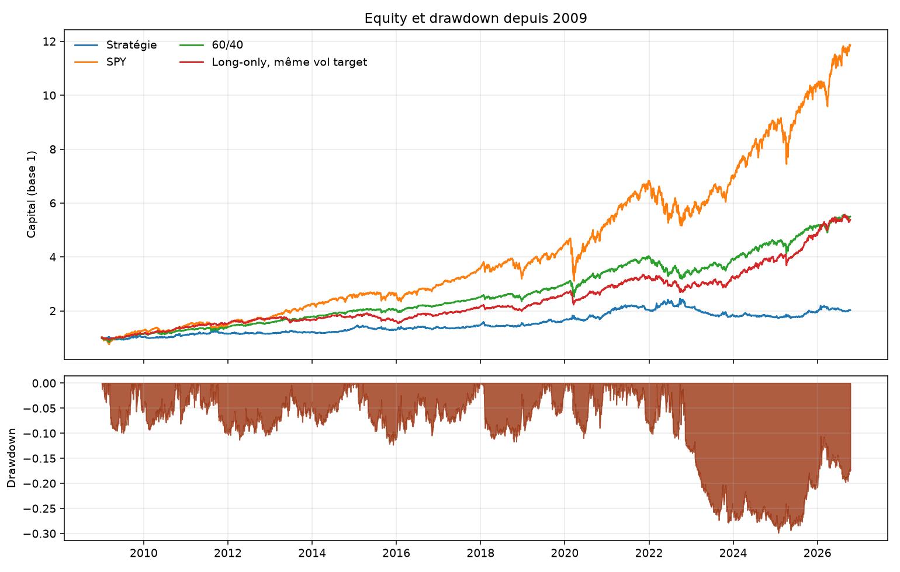
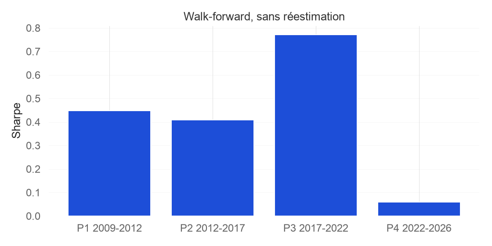

# Trend following and carry on US ETFs

A pre-registered implementation of the Carver framework on fourteen liquid US ETFs, from 2 January 2009 to 13 October 2026. The design, the rules, and the portfolio weights were fixed before the first performance number. Nothing was retuned afterwards.

The strategy has an annualised Sharpe ratio of 0.41 and a CAGR of 4.1%. SPY, over the same window, has 0.88 and 15.2%. A daily-rebalanced 60/40 has 0.99. A long-only book run through the same engine, at the same 13% volatility target and a constant forecast of +10, has 1.00. Transaction costs take about 0.06 of Sharpe, inside the speed limit of 0.17. The gap is the signals. The long-only book is the control: same universe, same costs, same sizing, no trend and no carry.

The printable note is [`docs/research_paper.pdf`](docs/research_paper.pdf). A French version is [`docs/research_note.md`](docs/research_note.md).

## The book

Each evening the position in instrument $i$ is

$$
N^*_{i,t} = \frac{\text{Capital}_t \times 0.13 \times F_{i,t} \times w_i \times \text{IDM}_t}{10 \times \sigma_{i,t} \times P_{i,t}}.
$$

$F$ is a combined forecast, scaled so that its typical absolute value is 10 and capped at $\pm 20$. The rules are three EWMAC trend speeds, 8/32, 16/64 and 32/128, and two carry speeds. Carry on equities is the trailing dividend yield minus the Treasury bill rate. Carry on bonds is a FRED yield spread. GLD, DBC, TIP and UUP have no carry and are trend only. When a carry value is missing, the remaining rule weights are renormalised.

Volatility is an EWMA of daily returns, span 35, blended 70/30 with its ten-year mean, with a floor at the fifth percentile of that blend. The floor uses data through the previous day. Annualisation is $\sqrt{256}$.

$w$ are handcrafted class weights: 20% US equities (SPY, IWM), 20% international equities (VGK, EWJ, EEM, EPP, EWC), 25% bonds (IEF, TLT, TIP, LQD), 25% commodities (GLD, DBC), 10% FX (UUP). The instrument diversification multiplier is $1/\sqrt{w'\Sigma w}$, with negative correlations set to zero and a cap of 2.5. It is estimated on an expanding window.

A forecast at the close of day $t$ earns the next close-to-close total return, including dividends. There is no open in the price files, so the backtest does not pretend to trade the next open. A no-trade band of 10% around the target suppresses small trades. Gross leverage is then capped at 2. Costs are half-spread times 1.5, plus borrow on shorts. Commission is zero.

## Result

| Book | Sharpe | CAGR | Volatility | Max drawdown |
|---|---:|---:|---:|---:|
| Strategy | 0.41 | 4.1% | 11.6% | −29.9% |
| SPY | 0.88 | 15.2% | 17.9% | −33.7% |
| 60/40 | 0.99 | 10.2% | 10.4% | −21.0% |
| Long-only, forecast +10 | 1.00 | 10.1% | 10.2% | −19.8% |

The strategy turns over 24 times a year. The long-only book turns over 2.1 times. Both are costed in the same engine. The long-only Sharpe net of costs is still about 0.99.



Four walk-forward blocks, with no refit. The sample starts in 2009 after two years of warmup. 2008 is not in the first block.

| Block | Sharpe | CAGR | Max drawdown |
|---|---:|---:|---:|
| 2009–2011 | 0.45 | 5.2% | −10.1% |
| 2012–2016 | 0.41 | 3.6% | −12.3% |
| 2017–2021 | 0.77 | 8.2% | −11.7% |
| 2022–2026 | 0.06 | −0.1% | −29.9% |



Taken one rule at a time, the slow trend carries the forecast. EWMAC 32/128 has a standalone Sharpe of 0.49 and turns over 13 times a year. EWMAC 16/64 has 0.34. EWMAC 8/32 has 0.05 and turns over 44 times. The two carry rules have Sharpes of 0.18 and 0.17, and maximum drawdowns past −55%. On this universe the fast trend and the ETF carry proxy do not pay for the turnover they generate.

Inside the combined book, commodities, bonds, FX and US equities contribute a positive Sharpe. International equities are the negative contribution. These are shares of the portfolio P&L, not standalone sleeves.

## Limits

The published Carver results are on futures. Futures carry is a term-structure slope. The ETF stand-in is a dividend yield or a FRED spread, small and slow. The test says that stand-in does not recover the futures result. It does not say the framework fails on futures.

The window is a long equity bull market. The long-only control collects that drift at a controlled volatility. The strategy spends part of its risk budget on shorts and on timing, and gives the drift back.

The backtest fills at the same close that produces the signal. A live order goes out at the next open. The paper-trading loop is there to measure that difference. It is not a second chance to retune the rules.

Parameters that were left unspecified in the design, and fixed before looking at the result, stay fixed. The leverage cap is 2. The paper account also refuses new risk when gross leverage is already above 1.5, and clips an order at 1% of average dollar volume.

## Paper trading

The same book runs against an Alpaca paper account. The client is constructed with `paper=True`. A macOS agent calls `python -m systrade.execution tick` every five minutes. The clock is New York. Twenty minutes after the session close, the tick writes the target, the orders, and the buffer to `data/live/trading.db`. It does not send. At the next open it sends passive limits. An order still working after five minutes is repriced. After thirty minutes it becomes a market order. A missed evening is caught by the next tick.

```bash
pip install -e ".[dev,reporting,live]"
pytest
python -m systrade.execution close --dry-run
```

Keys live in `.env`: `ALPACA_API_KEY`, `ALPACA_SECRET_KEY`, plus `TIINGO_API_KEY` and `FRED_API_KEY` for the data. `.env.example` lists the names. The dry run uses a broker in memory and writes `data/live/dry_run.db`. The scheduler log is `data/live/scheduler.log`.

## Layout

| Path | Role |
|---|---|
| `config/instruments.yaml` | Universe, handcrafted weights, borrow rates. |
| `src/systrade/data/` | Tiingo and FRED download, parquet store, integrity checks. |
| `src/systrade/risk/volatility.py` | EWMA blend and the shifted volatility floor. |
| `src/systrade/rules/ewmac.py` | EWMAC 8/32, 16/64, 32/128. |
| `src/systrade/rules/carry.py` | Equity dividend carry and bond yield carry. |
| `src/systrade/forecast/` | Forecast scalar and the diversification multiplier. |
| `src/systrade/portfolio/` | Volatility-targeted size, instrument weights, buffer, costs. |
| `src/systrade/backtest/engine.py` | Close-to-close backtest. The position at $t$ earns $t \to t+1$. |
| `src/systrade/backtest/metrics.py` | Sharpe, drawdown, walk-forward blocks. Annualisation $\sqrt{256}$. |
| `src/systrade/backtest/report.py` | The two figures above, plus the QuantStats tearsheet. |
| `src/systrade/execution/` | Alpaca paper broker, risk gates, passive orders, SQLite journal, scheduler. |
| `ops/com.systrade.paper.plist` | The five-minute macOS agent. |
| `docs/architecture.md` | The design document the backtest was not allowed to change. |
| `docs/research_paper.pdf` | The note. |
| `tests/` | 250 tests. Expanding windows, the buffer, the cost model, and the paper loop. |

## References

Carver, R. (2015). *Systematic Trading*. Harriman House.

Carver, R. (2019). *Leveraged Trading*. Harriman House.

Moskowitz, T., Ooi, Y. H. and Pedersen, L. H. (2012). Time series momentum. *Journal of Financial Economics* 104(2), 228–250.

Asness, C., Moskowitz, T. and Pedersen, L. H. (2013). Value and momentum everywhere. *Journal of Finance* 68(3), 929–985.

Koijen, R., Moskowitz, T., Pedersen, L. H. and Vrugt, E. (2018). Carry. *Journal of Financial Economics* 127(2), 197–225.

Harvey, C., Liu, Y. and Zhu, H. (2016). … and the cross-section of expected returns. *Review of Financial Studies* 29(1), 5–68.
